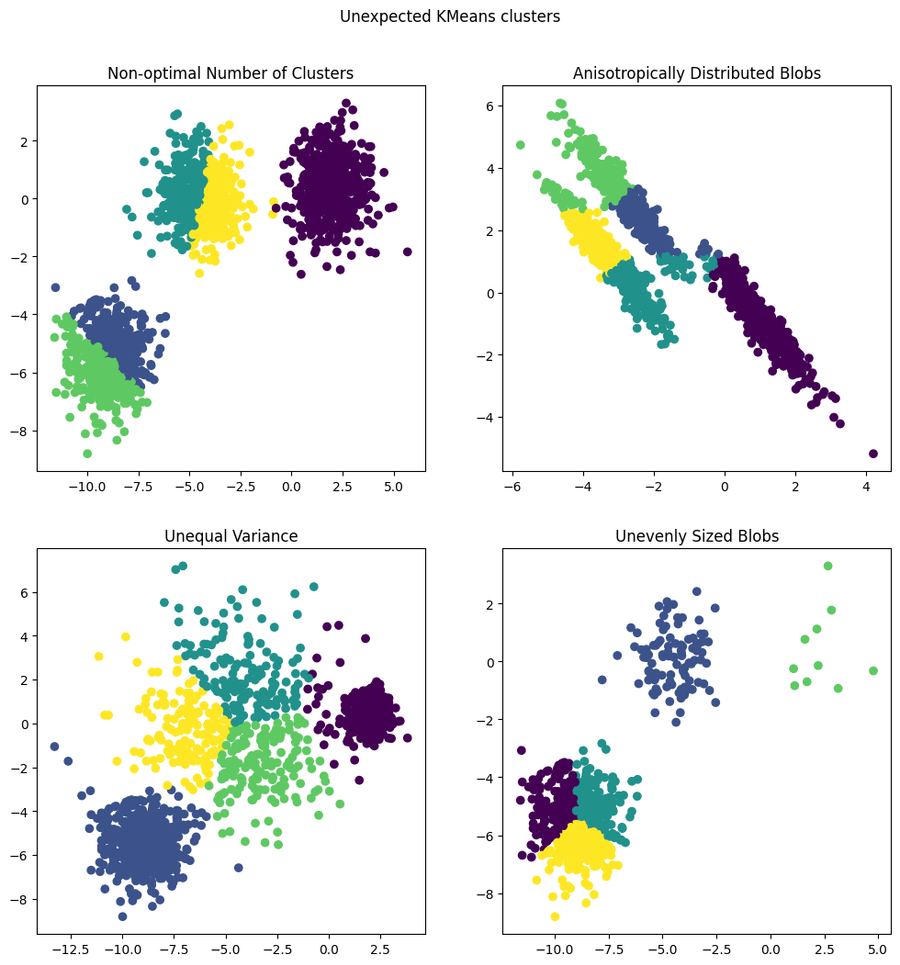
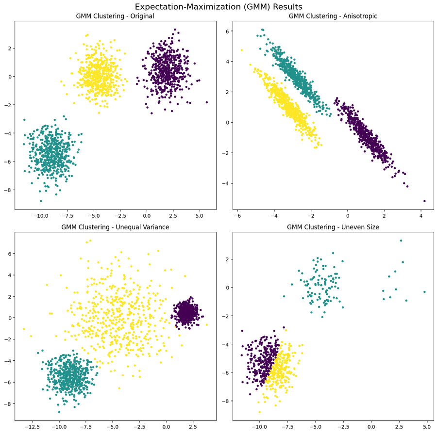

# Machine learning algorithms

Notebooks from my Intelligent Systems Engineering coursework at UASLP, where I
study how classic machine learning algorithms behave on data built to test
their assumptions.

> The notebooks and their explanations are written in Spanish.

## Clustering

| Notebook                                                              | What it shows                                                                                                                                       |
| :-------------------------------------------------------------------- | :-------------------------------------------------------------------------------------------------------------------------------------------------- |
| [K-Means](clustering/k_means.ipynb)                                   | When K-Means works and when it fails: a wrong number of clusters, stretched (anisotropic) clusters, unequal variance and very uneven cluster sizes. |
| [Expectation-Maximization](clustering/expectation_maximization.ipynb) | Gaussian mixture models fitted with EM on the same four datasets, and where they beat K-Means and where they do not.                                |



**K-Means with k = 5** on data that has 3 real clusters. It always returns k
clusters, so it splits real ones, and it cuts stretched clusters across
because it measures plain distance to each centroid.



**Gaussian mixtures (EM)** learn a covariance for each cluster, so they recover
stretched clusters and clusters with different spreads. They fail on the
dataset with clusters of 500, 100 and 10 points, which K-Means handles when it
is run with several initializations.

### Key takeaways

- No clustering algorithm wins on every dataset; plotting the data first says
  a lot about which one to use.
- K-Means assumes compact, round clusters of similar size and a known k.
- Gaussian mixtures handle elongated clusters and different variances, at the
  cost of more parameters to estimate.

## Run it

Requirements: Python 3.10 or newer.

```bash
git clone https://github.com/Ed-Phoenix/machine-learning-algorithms.git
cd machine-learning-algorithms
python -m venv .venv
.venv\Scripts\activate        # On macOS or Linux: source .venv/bin/activate
pip install -r requirements.txt
jupyter notebook
```

The data is generated inside each notebook with `make_blobs`, so there is
nothing to download. The notebooks also run on Google Colab.

## Credits

The datasets and the starting code come from the scikit-learn example
[Demonstration of k-means assumptions](https://scikit-learn.org/stable/auto_examples/cluster/plot_kmeans_assumptions.html)
(BSD-3-Clause license). The changes, the Expectation-Maximization comparison
and the explanations are mine.

## Author

Eduardo Carlos Benítez Lozano ·
[Portfolio](https://eduardo-benitez.vercel.app/en/) ·
[LinkedIn](https://www.linkedin.com/in/eduardo-carlos-benitez-lozano-191192379)
